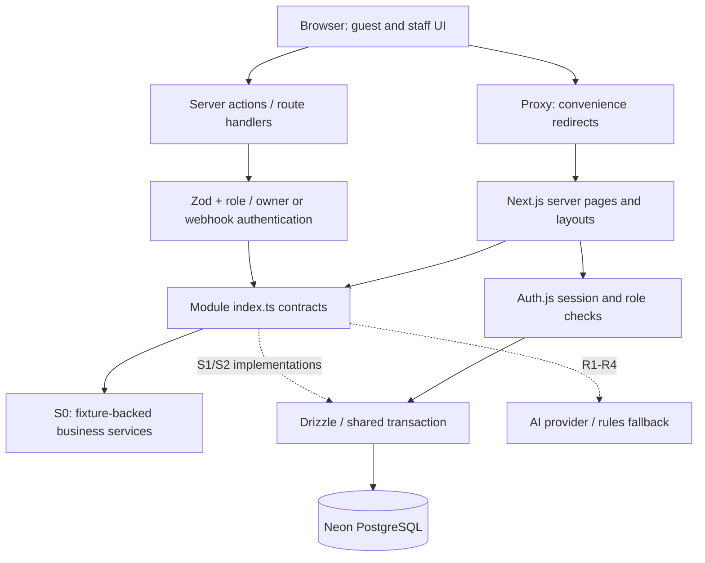

# S0 architecture and feature map

Snapshot: 7 Nov 2026 (IST), `codex/dev` HEAD `acebd3b`. This describes inspected source, not a verified deployment. See [independent review](s0-review-codex.md) for defects and approval gates.

**Labels:** REAL = implemented logic visible in source, not a claim of runtime validation; STUB = fixture-backed implementation; UNTESTED = implemented but not independently exercised here; NOT BUILT = absent. Local checkers could not run because dependencies were unavailable and pnpm store access was denied. No Neon connection or integration suite was run.

## Feature map

Paths below are relative to the repository; module paths are under `src/modules/`.

| Feature/module | Main files/folders | Important exports | Database tables | Data flow | State | Dependent S1/S2 stories |
|---|---|---|---|---|---|---|
| Authentication and roles | `src/lib/auth/{config,credentials,guards,actions}.ts`, `src/proxy.ts`, auth pages and protected layouts | `auth`, `signIn`, `verifyCredentials`, `requireRole`, `requireGuestOwner`, login/signup actions | `users` | Validated credentials → bcrypt comparison → signed JWT/session → server-side role/owner checks. Signup stores guest role and consent. Proxy only redirects based on cookie presence. | REAL; session/signup/browser behavior UNTESTED | B6, Q3–Q7, A1/A2; all protected entry points |
| Room catalog | `catalog/{index,fixtures}.ts` | `catalog.listRoomTypes`, `catalog.getRoomTypeBySlug` | Intended: `room_types`, `room_photos`, `rate_plans` | Four fixture room types → names/photos/occupancy/plan options. No DB reads yet. | STUB | G1–G3, B6 |
| Pricing and quoteHash | `pricing/{index,types,hash,fixtures}.ts` | `pricing.quote`, `quoteInputSchema`, `computeQuoteHash`, `Quote` | Intended: `daily_rates`, `tax_slabs`, `promo_codes`, catalog tables | Stay/occupancy/promo → nightly prices, discounts, GST, total and hash. Hash covers room/plan/dates/promo/nightly price inputs. Real DB pricing belongs to B1. | Hash/validation REAL; quote STUB | B1/B3/B6, G2/G3, R4, A1 |
| Inventory | `inventory/{index,fixtures}.ts` | `inventory.availability`, `availabilityInputSchema` | Intended: `inventory`, `blackout_dates`; expiry coordinates with booking | Stay → minimum stock across nights + sold-out/blackout indicators. Current implementation filters fixture room IDs only. | STUB; capacity constraints REAL | B2–B5, G2/G3, A2 |
| Booking holds and confirmation | `booking/{index,fixtures}.ts` | `booking.acquireHold`, `booking.confirmPayment`, `booking.get`, input schemas, `Booking` | Intended: `bookings`, `booking_nights`, `booking_events`, `payments`; coordinated inventory/pricing | Stay + displayed hash + authenticated guest → hold/price snapshot; payment result → state transition; ref + verified actor → booking detail. Only fixture paths execute today. | STUB; atomic transitions NOT BUILT | B3–B8, A2, later A5 |
| Payments | `payments/index.ts`; empty `src/app/api/payments/mock/` | `PaymentProvider`, `PaymentOutcome` (types only) | Intended: `payments`, `bookings`, `booking_events` | Server-owned booking total → mock charge success/failure/timeout → verified webhook → `booking.confirmPayment`. | Interface REAL; provider/route NOT BUILT | B5/B7/B8 |
| Guest UI | `src/app/(guest)/`, `src/components/layout/{guest-shell,auth-layout}.tsx` | Route components; `GuestShell`, `AuthLayout` | Auth uses `users`; future pages through catalog/pricing/booking contracts | Static home, working-source auth forms and guest-only account shell. Account currently always displays a placeholder empty state. | Shell/auth REAL + UNTESTED; room/booking/enquiry screens NOT BUILT | G1–G3, B6–B8, Q2 |
| Admin UI | `src/app/(staff)/admin/`, `src/components/layout/{staff-shell,staff-nav}.tsx`, `admin/index.ts` | `StaffShell`, `StaffNav`; admin module exports nothing | Future: rates/inventory/enquiries/notifications | Verified staff session → shell and overview. No editing, inbox or notifications service yet. | Shell/gate REAL + UNTESTED; business screens NOT BUILT | A1/A2, Q3–Q7 |
| Shared UI kit | `src/components/ui/`, `src/app/globals.css`, `src/app/dev/ui/` | `Button`, `Input`, `Select`, `DateRange`, `Stepper`, `Card`, `PriceBlock`, `HoldTimer`, `DataGrid`, state components, toast | None | Typed props → reusable controls, layout and loading/empty/error displays. Review pages compose fixture examples. | REAL; interactive/mobile behavior UNTESTED | All guest/admin screens; particularly B6/A1/A2 |
| Enquiries | `enquiries/{index,fixtures}.ts`; empty inbound API directories | `enquiries.ingest`, `enquiries.list`, `ingestInputSchema`, `Enquiry` | Intended: `enquiries`, `event_details`, `enquiry_events`, `reply_drafts`, `notifications` | Channel/contact/message → persisted pending row → processing → inbox. Today ingest returns constant `ENQ-4413`; list returns three examples. | STUB; persistence/forms/webhooks NOT BUILT | Q1–Q7, R2–R4 |
| AI router | `ai-router/{index,fixtures}.ts` | `aiRouter.process`, `classificationSchema`, `Classification` | Intended: `enquiries`, `reply_drafts`, `notifications`, `enquiry_events` | Enquiry ID → classify/extract → deterministic owner/lane/GM alert → human-approved draft. Current function looks up five examples. | STUB; providers/recovery/drafts NOT BUILT | R1–R4, Q5–Q7 |
| Schema and DB access | `src/db/schema/`, `src/db/migrations/`, `src/lib/db.ts` | Tables; `createDb`, lazy `getDb`, `Db`, `Tx` | 19 tables across identity/catalog/pricing/inventory/booking/enquiries/export | Drizzle schema → SQL migration; server services → pooled postgres-js client (`prepare:false`). DATE values use calendar strings; timestamps have timezone. | Definitions REAL; live migration state UNTESTED | All backend stories |
| Seed and DB safety | `src/db/{seed/,safety.ts,reset.mts,migrate.mts}`, `tests/integration/helpers.ts` | `assertSafeDestructiveTarget`, `childEnvForTests`, `dbHost`; seed-local pricing helpers | All app tables | Disposable target → destructive rebuild → 76 keys, 180-day prices/stock, five users, 30 bookings/enquiries. Tests require separate `TEST_DATABASE_URL`. | REAL scripts; execution UNTESTED; reset target defect in review | B1–B5, Q1, R3; demo screens |
| CI and deployment | `.github/workflows/ci.yml`, `package.json`, `vitest.config.mts`, `next.config.ts`, README | pnpm static/unit/build/integration scripts | CI disposable Postgres 16; intended hosted Neon | PR/main push → checks + build; separate job → test DB migrations/seed/integration. Planned Vercel runtime → Neon. | Workflow REAL + UNTESTED; F6 deployment NOT BUILT | All stories, F6, final H/D checks |

## Architecture

Solid auth→DB connectivity exists in source; most business-module DB paths and AI calls are planned (dashed). Server pages may call read contracts directly. Mutations must validate and authorize within their action/handler; a layout gate alone is insufficient.

## Data and contract rules that matter

- **Money:** integer paise; only pricing may compute application prices. A hold freezes nightly rates/discounts/GST and the total. Payments take that saved total, never a browser-supplied price. Seed-local price generation is separate and is not the application pricing engine.
- **Inventory:** site stock is the admin allotment, not physical room count. `sold + held <= allotment` is a DB CHECK. B3 must still lock all nights in order and acquire all or none. No concurrency safety beyond constraints is implemented yet.
- **Booking:** HELD → CONFIRMED/CANCELLED/EXPIRED; expired/cancelled are final. Late successful payment becomes REFUND_PENDING without reacquiring stock. Payment IDs are unique; B5 must implement duplicate no-ops and event writes transactionally.
- **Price freshness:** quote hash identifies price inputs; it does not authenticate guests. The current alternate-stay quote stub leaves a stale hash/night list (review R05).
- **Transaction gap:** `Tx` exists, but public pricing/inventory/expiry APIs do not yet expose the composition required by B3. Approval is required before adding these frozen contract capabilities (R01/R02).
- **AI safety:** real R stories must strip PII, validate output, place fallback/low confidence in unsorted, always alert GM for complaints and insert only pricing-derived quotes. `after()` plus persisted state/sweep/Retry is planned; drafts never auto-send.
- **Mapping:** DB IDs are UUIDs; fixtures use readable strings. DB enquiry confidence is numeric/string and needs conversion to the contract's number; owner role and summary require mapping. Q1 must generate unique enquiry IDs.
- **Auth rendering:** protected account/staff components call `connection()` then verified auth inside Suspense. This accommodates request-time rendering; it does not relax authorization. JWT roles persist for an eight-hour session.
- **DB operations:** seed/reset are destructive. Dedicated test URL, host comparisons and production flag checks are present, but production identity is not proven by the guard. Reset's chained migration can select a different target (R03/R04). No DB operation was run for this map.
- **Tests:** 44 unit cases and 13 integration cases exist in source. Most contract tests exercise fixed fixtures; seed pricing tests do not prove B1. Actual booking races, provider failures and browser end-to-end flows are future story tests.

## Practical handoff

Start guest screens and intake with coherent fixtures and server-side validation. Obtain scrum-master approval for transaction composition, hold-error behavior and existing hold/payment shape questions before implementing B1–B5; obtain locked-area ownership separately. Clear database target safety and clean-run CI/build evidence before F6. Keep optional export, metrics, advanced event forms and extra FK indexes behind the remaining P0 work.
