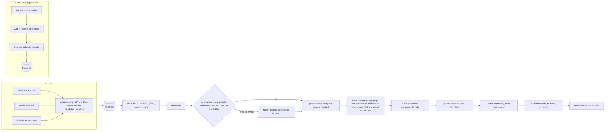

# TDD material pack (S3 Phase 8)

Raw material for the Technical Design Document. Facts, numbers and repo-relative links only. Every number cites the file it came from. `(unverified)` = could not be confirmed from a file. Phase 6 numbers come from `docs/final-check.md`.

Written on branch `claude/s3-tdd-pack` from `main` at `b8b589f`; Phase 5 (merged at `38ff922`) and Phase 6 results added before merge.

---

## 1. Links

- GitHub: https://github.com/Bored-Pawar/ISOCODE_Resort_booking_and_management_Platform
- Live URL: `<to fill after deploy>` (F6 deploy is still `todo` in `docs/06-progress.md`; Phase 7 prepared it but did not deploy, `docs/s3-overnight-handoff.md`)
- Run and deploy: [`deployment.md`](../deployment.md), [`README.md`](../README.md)

---

## 2. Architecture

### Style and stack (`docs/02-architecture.md`)
- Modular monolith: one Next.js app, one Postgres database, one deploy. Why: one developer, about 72 hours, single deploy; microservices add cost with no scoring benefit.
- Next.js 16 App Router, TypeScript, Server Components and Server Actions; Tailwind 4; PostgreSQL on Neon; Drizzle (raw SQL for locking queries); Auth.js credentials (two providers, guest and staff, JWT sessions, `docs/06-progress.md` 2026-11-07); Zod on every input and every AI output; Vercel AI SDK 7 `generateText` + `Output.object`; Vitest (unit + Postgres integration); Playwright; Vercel + Neon + Vercel Cron; pnpm.
- `cacheComponents` on: runtime reads (cookies, searchParams, clock) sit inside `<Suspense>`; `await connection()` before `auth()` (`docs/06-progress.md` S0 decisions, `docs/tdd-notes.md` F1).

### Modules (`src/modules/*`, each public surface is `index.ts`)
| Module | Owns | Notes |
|---|---|---|
| `catalog` | room types, photos, rate plans (read only) | DB read cached with `"use cache"` 1 hour (`docs/tdd-notes.md` G2) |
| `pricing` | daily rates, promos, GST slabs, `quote()`, `quoteHash` | only price source; `admin.ts` for rates and promos; `internal.ts` `quoteInTx` |
| `inventory` | allotment, holds counters, blackouts, `availability()` | LOCKED area; `admin.ts` allotment and offline/online; `internal.ts` `lockNights`, `adjustNights` |
| `booking` | state machine, hold, expiry, confirm, cancel, staff reads | LOCKED; owns every cross-module transaction |
| `payments` | `PaymentProvider`, `MockProvider`, signed webhook handler | LOCKED |
| `enquiries` | ingest, inbox queries (`staff/`), queue claims (`internal.ts`), send | `staff/send.ts` is the only writer of `sent_at` / `approved_by` (`docs/tdd-notes.md` S2 inbox) |
| `ai-router` | classify, PII, grounding, routing, quote selection, draft, guard, recovery | consumes `enquiries/internal.ts` (approved D6 exception, `docs/02-architecture.md`) |
| `ai-provider` | provider selection (`factory.ts`) and one structured SDK transport | no domain or DB imports (`docs/s2-r1-r4-implementation-handoff.md`) |
| `admin` | facade for `pricing/admin.ts` and `inventory/admin.ts`; pure `rules.ts`, `schemas.ts` for client components | `docs/02-architecture.md` S2 admin |

Approved boundary exceptions (`docs/01-booking-core.md` Contracts, `docs/02-architecture.md`): `booking` may import `pricing/internal` and `inventory/internal` (R01); `inventory/index.ts` calls the booking-owned scoped lazy-expiry wrapper; seed and tests may import pure `pricing/calculation.ts`; only `ai-router` imports `enquiries/internal.ts`.

### Request flow
1. Page (Server Component) or server action / route handler.
2. Zod parse of input.
3. Auth: `requireRole()` / `requireGuestOwner()` for guests; staff entry points call `requirePermission(capability)` from `src/lib/auth/permissions.ts` (one role x capability table; `navFor` builds nav; `enquiryVisibility` filters the inbox). Middleware (`proxy.ts`) only redirects. A staff page the role cannot use renders the 403 screen; actions return `FORBIDDEN` (`docs/02-architecture.md` Security 1). Each admin service checks `can()` again (`docs/tdd-notes.md` S2 admin).
4. Module `index.ts` service call (`guestId` and actor always from the session, never the client, `docs/01-booking-core.md` Contract notes 2, 5).
5. Module code -> Drizzle / raw SQL -> Postgres. Business failures return `{ ok: false, code }`, never thrown (`docs/01-booking-core.md` Rollback rules 2).

Recorded exemptions from `requireRole` (`docs/02-architecture.md` "Machine and public entry points"): cron `/api/cron/expire-holds` (Bearer `CRON_SECRET`), inbound webhooks `/api/inbound/{email,whatsapp}` (`x-inbound-secret` vs `INBOUND_WEBHOOK_SECRET`, constant time, fail closed), mock payment webhook `/api/payments/mock` (HMAC SHA-256 `x-payment-signature`), public `/enquire` form and `/book` read page. All still validate with Zod.

Security hardening (S3 Phase 2, `docs/02-architecture.md` Security 5 to 8): in-memory sliding-window rate limits per IP and per email/contact/guest (login 30 per IP, 20 per IP + email, 50 per email per 15 min; sign up 20 per IP and 3 per email per hour; `/enquire` 6 per IP, 3 per IP + contact, 10 per contact per 10 min; hold and pay 30 per IP, 20 per guest per 10 min); per server instance only. CSP with `script-src 'self' 'unsafe-inline'`, HSTS two years, `X-Frame-Options: DENY`, nosniff, Referrer-Policy, Permissions-Policy. `POST /api/auth/callback/*` and `/api/auth/signin/*` return 404. Errors logged via `safeError()` (class name and SQLSTATE only).

### Transaction ownership (`docs/01-booking-core.md` Contracts)
1. `booking` owns every transaction that spans modules: `acquireHold`, `confirmPayment`, `releaseExpiredHolds`, `cancelHeld`. It opens `db.transaction` and passes `Tx` to helpers; helpers never open or commit.
2. `pricing` and `inventory` touch only their own tables, using the given `tx`.
3. Public reads (`pricing.quote`, `inventory.availability`) use their own connection, no transaction (availability first calls booking-owned scoped lazy expiry).
4. Enquiry claims and settlement open short enquiries-owned transactions; no transaction spans a provider call (`docs/02-architecture.md` Security, D6; `docs/04-ai-router.md` R2).

### Lock order (`docs/01-booking-core.md` Lock order; `docs/06-progress.md` 2026-11-08 S2 review M1/M2)
0. `acquireHold` only: first statement `SELECT pg_advisory_xact_lock(hashtextextended('hold:' || guestId, 0))` (per guest, not per stay).
1. Then `bookings` rows (expiry: `FOR UPDATE SKIP LOCKED`), then `inventory` rows.
2. Inventory rows always locked ordered by `(room_type_id, date)` ascending, in one statement per lock step, across every room type of the cart (B10): `SELECT ... WHERE room_type_id = ANY($types) AND date >= $in AND date < $out ORDER BY room_type_id, date FOR UPDATE`.
3. Never lock `payments` before `bookings`; a conditional `UPDATE bookings ... WHERE status='HELD'` is the only booking write in `confirmPayment`.
4. `40P01` / `40001` retry the whole transaction once, then `SOLD_OUT`.
- Admin paths use the same inventory order so edits and holds queue rather than deadlock: `setAllotment` (A2) and `setOffline`/`setOnline` (A3) lock target rows in `(room_type_id, date)` order (`docs/01-booking-core.md` A2, A3).
- Other advisory locks: blackout edits take `pg_advisory_xact_lock` first in `setOffline` and `setOnline` (holds never take it) (`docs/s2-admin-handoff.md` Review); promo create takes an advisory lock per uppercase code (`docs/01-booking-core.md` A4); webhook ingest takes `pg_advisory_xact_lock` on the provider message id (`docs/tdd-notes.md` Q1).
- Deadlock proof: B10 new test 1 races `[T1, T2]` vs `[T2, T1]` and checks `pg_stat_database.deadlocks` (`docs/tdd-notes.md` B10 Locking).

### AI pipeline (`docs/04-ai-router.md`)
ingest (row saved `ai_status='pending'` first) -> Next `after()` + bounded batch-five sweep on ingest and inbox load + daily cron sweep -> claim (`FOR UPDATE SKIP LOCKED`, attempt counter, cap 3) -> PII redaction -> one structured provider call (classification + extraction + `draftText` with `{{QUOTE}}`) -> Zod -> rules fallback on any error -> server grounding against original text -> deterministic routing + complaint detector -> quote selection through public catalog/inventory/`pricing.quote` -> prose guard / template -> atomic settle (classification, one unapproved draft, one alert, one `classified` event) -> staff edit, approve and send to mock outbox.



---

## 3. Data model

Source: `docs/03-data-model.md`, `src/db/schema/{identity,catalog,inventory,booking,enquiries}.ts`, migrations `src/db/migrations/0000_dashing_mephistopheles.sql`, `0001_adorable_starhawk.sql` (B10).
Conventions: money integer paise (`*_paise`), dates `DATE` in IST, timestamps `timestamptz`, ids `uuid` except `enquiries.id` (`ENQ-xxxxx`) and `bookings.ref` (`CA-` + 5 chars).
Count: 20 tables in `src/db/schema/*.ts` (S0 had 19 tables, 23 CHECKs, `docs/tdd-notes.md` F2; B10 added `booking_rooms`).

| Table | Key columns and constraints |
|---|---|
| `users` | email UNIQUE; role CHECK IN ('guest','reservations','sales','gm'); consent_at, consent_version (DPDP) |
| `room_types` | slug UNIQUE; total_units CHECK > 0; max_occupancy CHECK >= max_adults; max_children stored, not enforced |
| `room_photos` | url, alt, width, height, blur_data |
| `rate_plans` | code CHECK IN ('EP','CP','MAP'); refundable, active |
| `daily_rates` | PK (room_type_id, rate_plan_id, date); price_paise CHECK > 0; updated_by |
| `tax_slabs` | min_paise, max_paise (null = no cap), gst_bp, effective_from |
| `promo_codes` | code UNIQUE; kind CHECK IN ('pct','flat'); value CHECK > 0; used_count CHECK >= 0; max_uses, min_nights, valid_from/to |
| `inventory` | PK (room_type_id, date); allotment, sold, held each CHECK >= 0; **CHECK (sold + held <= allotment)** (`inventory_capacity_check`) |
| `blackout_dates` | room_type_id null = all rooms; CHECK (end_date >= start_date); reason, created_by |
| `bookings` | ref UNIQUE; status CHECK IN ('HELD','CONFIRMED','EXPIRED','CANCELLED'); CHECK (check_out > check_in); hold_expires_at; quote_hash; subtotal/discount/gst/total paise. Indexes (status, hold_expires_at), (guest_id), (check_in) |
| `booking_rooms` (B10) | line_no CHECK BETWEEN 1 AND 4; adults CHECK >= 1; children CHECK >= 0; UNIQUE (booking_id, line_no); FK booking ON DELETE CASCADE; indexes (booking_id), (room_type_id) |
| `booking_nights` | PK (booking_room_id, date); rate, discount, gst_bp, gst paise (frozen price snapshot) |
| `payments` | provider_payment_id UNIQUE (duplicate webhook guard); status CHECK IN ('SUCCESS','FAILED','REFUND_PENDING') |
| `booking_events` | from_status, to_status, actor, note (written in the same tx as each transition) |
| `enquiries` | channel CHECK IN ('web','email','whatsapp','event_form'); category CHECK (room, wedding, offsite, complaint, other) null; confidence numeric(3,2); extracted jsonb (holds `source`, `consent`, `grounding`, `guest_hint`); ai_status CHECK IN ('pending','processing','ok','fallback','failed'); ai_attempts; lane CHECK IN ('sorted','unsorted'); status CHECK IN ('new','assigned','replied','closed'); is_complaint; first_reply_at. Indexes (lane, status), (owner_id, status), (ai_status, ai_updated_at) |
| `event_details` | enquiry_id PK FK; event_type, dates, guests, budget_paise, needs jsonb |
| `reply_drafts` | body, quote jsonb (from pricing), provider, model, prompt_version, edited, approved_by, sent_at |
| `enquiry_events` | action CHECK IN ('classified','rerouted','edited','sent','closed'); from_value, to_value (attention notes encoded here, `docs/06-progress.md` 2026-11-09) |
| `notifications` | kind CHECK IN ('complaint','unsorted'); read_at |
| `export_runs` | run_date UNIQUE (A7 export, not built) |

Seed (`docs/03-data-model.md`, `src/db/seed/data.ts`, `docs/tdd-notes.md` F3): 4 room types (Plantation Room 40 units / allotment 16 / max occupancy 3; Estate Suite 24 / 10 / 4; Garden Villa 8 / 3 / 5; Pool Villa 4 / 2 / 6); 12 photos; 3 plans per type (EP, CP +Rs 800, MAP +Rs 2,200, MAP non-refundable); 180 days of rates and inventory with season multipliers (Dec, Jan 1.3; Jun to Aug 0.8; other months 0.85 to 1.1); GST slabs 5% to Rs 7,500 and 18% above, effective 2025-09-22; promos WELCOME10 (10%, active), HILLS1000 (flat Rs 1,000, active), MONSOON20 (20%, inactive); 2 blackouts; 3 staff + 2 guests; 30 bookings across all states, 36 room lines, 5 multi-room (`docs/s2-multiroom-handoff.md`); 30 labelled enquiries (`src/db/seed/enquiries.data.ts`).

Schema gaps recorded: no FK indexes such as `payments.booking_id` (`docs/06-progress.md` S0 open question 3); no index on `enquiry_events.enquiry_id`, summary search `ILIKE` on jsonb (`docs/s3-overnight-handoff.md`); no unique index on `extracted->'source'` (`docs/tdd-notes.md` Q1).

---

## 4. Main flows

### 4.1 Booking (`docs/01-booking-core.md`, `docs/tdd-notes.md` S2 booking flow)
State machine:
```
(start) --hold ok--> HELD --pay ok, hold valid--> CONFIRMED --staff--> CANCELLED
                      +--timeout--> EXPIRED (final); late payment -> payment REFUND_PENDING, booking stays EXPIRED
                      +--guest abandons / cancelHeld--> CANCELLED
```
| From | To | Trigger | Inventory |
|---|---|---|---|
| none | HELD | step 2 submit | held += units, every night |
| HELD | CONFIRMED | payment success and `hold_expires_at > now()` | held -= units, sold += units |
| HELD | EXPIRED | expiry release | held -= units |
| HELD | CANCELLED | guest cancels | held -= units |
| CONFIRMED | CANCELLED | staff | sold -= units |

- B10: one booking = 1 to 4 room lines (`booking_rooms`), shared dates, one hold, one payment, one total. Line fits when `1 <= adults <= max_adults` and `adults + children <= max_occupancy`.
- Every transition is one conditional update (`... WHERE id=$1 AND status='HELD' AND hold_expires_at > now() RETURNING *`) plus a `booking_events` row in the same transaction.
- Acquire hold (one tx): guest advisory lock -> live-hold lookup for same guest and exact stay (idempotent, Contract note 7) -> scoped `releaseExpiredHoldsInTx` -> `lockNights` (one ordered statement) -> reject whole cart on any missing night, short stock or blackout -> `quoteInTx` -> compare `quoteHash` (mismatch: `PRICE_CHANGED` + new quote, no stock) -> `adjustNights` -> insert booking, rooms, nights (snapshot), event. Codes: `SOLD_OUT`, `BLACKOUT`, `NO_RATE`, `PROMO_INVALID`, `OVER_OCCUPANCY`, `INVALID_INPUT`, `PRICE_CHANGED`; guest action adds `OUTSIDE_WINDOW` (3 month window).
- `quoteHash` = first 32 hex of SHA-256 over dates, promo and each line in order (type, plan, per night date, rate, discount, GST bp); occupancy excluded (`docs/01-booking-core.md` Contract note 1; `src/modules/pricing/hash.ts`).
- Pricing: per cell (line x night) rate minus discount share, then GST slab by that value and the night's `effective_from`; never a per-date sum across rooms; totals summed without re-rounding; flat promo allocated over cells in (line_no, date) order (R09-safe).
- Expiry: `UPDATE bookings SET status='EXPIRED' WHERE id IN (SELECT ... FOR UPDATE SKIP LOCKED) RETURNING id`, then decrement `held` per (type, date) in the same tx. Lazy expiry before availability, hold and confirm; daily cron `/api/cron/expire-holds` 00:00 UTC / 05:30 IST (`vercel.json`) as a safety net.
- Payments: `payBooking` (Zod, `requireRole('guest')`, owner check, amount = saved `total_paise`, provider id `mock_<bookingId>_<attemptId>`) -> `MockProvider` (succeeds / declined / timeout) signs HMAC and calls the same handler as `/api/payments/mock` in process -> `booking.confirmPayment`: insert payment (unique id; duplicate = `ALREADY_CONFIRMED`), conditional HELD -> CONFIRMED, `adjustNights(held -1, sold +1)`, event, promo `used_count +1`, all one tx. Wrong amount -> `AMOUNT_MISMATCH`. Not HELD or expired -> `REFUND_PENDING` payment, booking untouched. Payment failure does not change booking status.
- UI steps (`docs/tdd-notes.md`): `/rooms` stay builder (cart in URL, server re-quote on each edit, promo) -> `/book/details` (server re-quote, inline sign up with DPDP consent, `holdStay`) -> `/book/pay/[ref]` (HoldTimer, 3 test outcomes, pay disabled under 2 minutes, Refresh hold = `cancelHeld` + fresh hold) -> `/booking/[ref]` (confirmation, `.ics`, rendered email at `/booking/[ref]/email`). `/account` My bookings: Resume payment, Cancel for a live hold.

### 4.2 Enquiry to reply (`docs/04-ai-router.md`, `docs/02-architecture.md` Q1 to Q3, `docs/tdd-notes.md` S2 inbox)
1. Ingest: web form `/enquire` (Zod, honeypot, consent, optional event fields -> `event_details`, channel `event_form`), Postmark-shaped email webhook, Meta-shaped WhatsApp webhook, `/dev/test` simulator (6 presets). All call `enquiries.ingestFrom()`; row saved `ai_status='pending'` before any AI call; idempotent on provider message id (`extracted.source`). Webhooks: 401 bad secret, 400 malformed, 256 KB cap.
2. Classify: claim -> redact -> one provider call -> Zod -> rules fallback on error (section 5).
3. Ground: `groundExtraction(raw_text, classification, todayIST())` checks dates and explicit adult/child counts against the original message; result in `extracted.grounding` (`ok|missing|unsupported`).
4. Route: deterministic (`src/modules/ai-router/routing.ts`): room -> reservations; wedding, offsite -> sales; complaint -> gm; `status !== 'ok'` or confidence < 0.7 or category `other` -> no owner, lane unsorted; complaint detector always alerts the first GM.
5. Draft: model prose with `{{QUOTE}}`; quote only from `pricing.quote({ rooms })` over EP plans, up to 4 lines, stock checked, no hold; price only attached when dates and guests are both grounded `ok`; unsafe or absent prose -> safe template.
6. Staff (`/admin/inbox`, Q4 to Q7): lanes by role (Mine, Rooms, Weddings, Offsites, Other, Complaints GM, Unsorted GM, Needs attention, Failed AI GM), visibility in SQL, keyset pages of 25; detail with editable fields (date or guest edit re-runs only quote + draft via `aiRouter.draftForStaff`, no model call), one-click re-route logged `rerouted`, Retry AI (GM); draft editor with Regenerate, Approve and send (confirm, once: locks enquiry then draft, `WHERE sent_at IS NULL`, `first_reply_at` COALESCE, logs `sent`), rupee figure not in the quote shows "Prices should come from the quote" and logs `draft:price-warning`; draft version `sha256(body, quote)` gives `STALE_DRAFT` on save/send after a rebuild (`docs/06-progress.md` S3 Phase 1). Send goes to the mock outbox `/dev/outbox` Replies tab; nothing is sent automatically.
7. GM bell (Q7): unread count, list, mark one or all read; every query `user_id = me`.
8. Sales attention request: "Ask reservations and GM to look" with a note; reservations/GM mark seen with a reply note; both `enquiry_events` rows (`docs/06-progress.md` 2026-11-08, 2026-11-09).

### 4.3 Admin edits (`docs/01-booking-core.md` A1 to A4, `docs/tdd-notes.md` S2 admin)
| Story | Screen | Rule |
|---|---|---|
| A1 rates | `/admin/rates` | grid room type x plan x 30 days, weekends (Fri, Sat nights) shaded; single cell and bulk (rooms, plans, dates, weekdays, presets) with "Updates N prices across M rooms" preview; one `INSERT ... ON CONFLICT ... DO UPDATE WHERE price IS DISTINCT`; whole rupees 1 to 5,00,000; today IST to today + 179; existing bookings keep frozen nights; open carts get `PRICE_CHANGED` |
| A2 allotment | `/admin/allotment` | allotment large, `sold · held` small; scoped lazy expiry, insert missing rows, ordered lock, one conditional `UPDATE ... WHERE sold + held <= new AND new <= total_units`; refused dates report min and cap ("At least N (already sold or held)", "At most N (total rooms)"); other dates apply |
| A3 offline / blackout | panel on `/admin/allotment` | offline writes a blackout with required reason, merges overlapping or touching same-scope rows; online deletes, trims or splits; "Check bookings first" warning lists live bookings (up to 1,000 via `booking.listOverlappingForStaff`, then `truncated`); blackouts block new holds only, existing bookings stand; hatched cells; room type inside an all-rooms blackout refused (`ALL_ROOMS_OFFLINE`) |
| A4 promos | `/admin/promos` | list (Active, Off, Ended, Used up), create (uppercase, no case-only duplicates), two-step switch off; pct 1 to 100 or flat whole rupees; min nights 1 to 14; validity = stay nights; deactivated -> `PROMO_INVALID`, confirmed bookings keep discount |
| A5 bookings | `/admin/bookings`, `/admin/bookings/[ref]` | filters, detail timeline, Refund pending tab (reservations, gm) |

Role matrix (`docs/s2-admin-rbac-runbook.md` section 1, `src/lib/auth/permissions.ts`): reservations has rates, allotment, availability, promos, bookings, room/other enquiries, attention.resolve; sales has wedding/offsite enquiries and attention.request only; gm has everything incl. complaints, unsorted and the bell.

---

## 5. AI part

Source: `docs/04-ai-router.md`, `docs/s2-ai-provider-setup.md`, `src/modules/ai-router/*`, `src/modules/ai-provider/*`.

### Providers (env `AI_PROVIDER`, chosen in `modules/ai-provider/factory.ts`, model from `AI_MODEL`)
| Value | Use |
|---|---|
| `google` | documented demo default (Gemini free tier; free-tier content may be used by Google, so synthetic data only) |
| `groq` | `@ai-sdk/groq`, suggested `openai/gpt-oss-120b` since Phase 6 (R5 ran on `gpt-oss-20b`) and set in `.env.local` (`docs/s3-overnight-handoff.md`) |
| `anthropic` | optional production option |
| `local` | Ollama / OpenAI-compatible at `LOCAL_AI_BASE_URL`; benchmark recommended Qwen3 4B locally (`docs/reviews/r1-r4-ollama-model-benchmark.md`) |
| `rules` | no key, no network; keyword classifier, confidence 0.5 (0.3 for `other`, `src/modules/ai-router/fallback.ts`), always unsorted |

- Missing credentials or model -> sanitized `NOT_CONFIGURED` -> rules fallback. No hosted model id guessed when unset.
- Timeouts: 10 s per attempt for every provider (`ATTEMPT_TIMEOUT_MS = 10_000`, `execute.ts`), at most one transient retry, a 429 retried only if Retry-After is 1 s or less: max 21 s provider budget, below the 120 s stale lease. `maxOutputTokens: 1800` (`transport.ts`).
- **Groq key failover** (`docs/04-ai-router.md`; `docs/06-progress.md` S3 Phase 0): keys `GROQ_API_KEY_1` to `_4` in order, empty skipped; 429 or 401/403 cools that key in memory per instance for Retry-After, else 60 s (`KEY_COOLDOWN_MS = 60_000`), next key tried at once inside the same 10 s attempt; each key at most once per attempt; timeouts and 5xx keep the normal one retry; all failing or cooling -> `RATE_LIMIT` / `NOT_CONFIGURED` -> rules fallback (unsorted). Only log line `groq key rotated` with a count; no key value or slot anywhere. Groq called with non-strict `json_schema` (`providerOptions.groq.strictJsonSchema = false`) because strict mode rejected optional properties with HTTP 400 (`docs/eval/r5-results.md`).

### Schema (router-owned Zod, `src/modules/ai-router/schema.ts`)
`{ category: room|wedding|offsite|complaint|other, confidence 0..1, dates {from?, to?, text?}, guests {adults?, children?, total?}, budget {amountInr?, text?}, language, summary, draftText? }`. R08 tightened: invalid calendar dates, reversed ranges, negative or fractional counts reject the whole response (`docs/reviews/r1-r4-architecture-fault-audit.md` Q12). Prompt version `enquiry-v2-audit` (`src/modules/ai-router/prompts.ts`); `prompt_version` and `model` stored on every draft.

### PII redaction (`docs/04-ai-router.md` Safeguards; audit M7)
Provider input = redacted message + reference IST date only; sender fields, source keys and consent metadata excluded. Scrubs known sender tokens, introduced names, sign-off name lines, email, mobile, 8+ digit STD landlines, PIN-bearing address segments, forwarded headers, common IDs; protects date/count tokens. Raw text stays on the server (grounding, routing, matching). Limits: unintroduced names, addresses without cues, unusual phone formats, novel ids may escape; minimization, not entity recognition.

### Grounding (`docs/04-ai-router.md` Output schema; audit B1 fix)
Server checks dates (ISO, Indian d/m[/y], English day-month / month-day, shared ranges, Dec-Jan rollover; omitted year -> next non-past occurrence) and explicit adult/child counts against the original message. Conflicting, invalid or unsupported -> fails closed (no quote) without downgrading classification. Totals never imply adults; omitted children disclosed as an estimate assuming none; unnumbered children need clarification. Room preference from original text; English + Hindi/Hinglish aliases map to the 4 types only; named villas never broaden to cheaper types.

### Routing rules
See 4.2 step 4. Non-negotiables (`docs/00-requirements.md` AI rules): low confidence or failed -> unsorted lane the GM sees; one-click re-route; never auto send; prices only from the rate table; complaints always alert the GM. Complaint detection = model category OR model `isComplaint` flag OR English/Hinglish/Devanagari detector on original text, whatever the confidence; mixed intents keep their owner plus a GM alert (audit M5).

### Draft and price guard (`docs/04-ai-router.md` Draft, M6; `src/modules/ai-router/price-guard.ts`)
Model prose may contain only the `{{QUOTE}}` placeholder for money. Currency, unlabelled numbers, discounts, action/availability promises and links fail the guard; Hindi/Hinglish/English confirmations and financial promises rejected; Devanagari digits normalized; numeric facts need original-text or server evidence. Unsafe or absent prose -> safe template; classification stays `ok`. Guard runs before trusted quote substitution. Inbox adds a second check at send (price warning). Saved-output replay: Qwen3 72.2% -> 67.8% template fallback, Qwen2.5 66.7% -> 62.2%; under-30% target not met (`docs/reviews/r1-r4-draft-guard-evaluation.md`).

### When wrong or unsure
- Provider error, timeout, 429, invalid JSON or Zod failure -> rules classification, `ai_status='fallback'`, lane unsorted, GM sees it.
- Confidence < 0.70 or category `other` -> unsorted.
- Wrong but confident category -> staff re-route in one click (logged); complaint alert still fires from the original-text detector.
- Ungrounded dates or party -> no price, draft asks for clarification.
- Processing crash -> row recoverable after 2 minutes; at most 3 attempts, then `failed/ATTEMPTS_EXHAUSTED`, unsorted, GM Retry; staff edits cancel in-flight work (`failed/STAFF_CHANGED`).
- Nothing is sent without a staff click.

### R5 numbers (quoted exactly from `docs/eval/r5-results.md`; run 2026-11-09T00:25 UTC, 30 labelled synthetic seeds, prompt `enquiry-v2-audit`)
| Metric | Groq `openai/gpt-oss-20b` | Rules only |
|---|---|---|
| Model category accuracy (invalid answers counted wrong) | 20/30 (67%); 20/21 of valid answers (95%) | n/a (no model) |
| End to end category (Groq: 21 model rows, 20 correct, plus 9 rules-fallback rows, 9 correct; the rules are seed tuned) | 29/30 | 30/30 |
| Valid structured answer | 70% | n/a |
| Fallback to rules | 30% | 100% |
| Unsorted lane rate | 43% | 100% |
| **Complaint recall (every complaint notifies GM), n = 5** | **5/5** | **5/5** |
| GM alerts on non-complaints | 0 | 0 |
| Draft template fallback (model prose rejected or absent) | 47% | 100% |
| Safe model draft rate (of structured answers) | 76% | n/a |
| HTTP 429 seen (absorbed by key failover) | 7 | 0 |
| Timeouts | 0 | 0 |
| Median / p95 latency | 1588 / 2346 ms | n/a |

Per category (end to end, after fallback), Groq / rules: room 9/9 / 9/9; wedding 6/6 / 6/6; offsite 5/5 / 5/5; complaint 5/5 / 5/5; other 4/5 (80%) / 5/5.
Grounding, Groq: dates missing 22, ok 3, unsupported 5; guests missing 27, ok 3; room missing 25, ok 5. Rules: dates missing 27, ok 3; guests missing 27, ok 3; room missing 25, ok 5.
Findings quoted: "9 of 30 Groq calls ended in the sanitized `INVALID_RESPONSE`" (ENQ-4410, 4383, 4389, 4392, 4394, 4397, 4403, 4406, 4407), "the cause is not established"; wrong but valid: ENQ-4408 (other read as room); the rules' 30/30 "is not a generalisation claim"; this eval passes no server quote, so price lines are covered by `price-guard` and `ai-routing` tests. Brief enquiries: ENQ-4411 and ENQ-4412 classified by the model; ENQ-4410 hit `INVALID_RESPONSE` and was classified `wedding` by rules (unsorted). Raw JSON: `docs/eval/ai-evaluation-live-model.json`, `docs/eval/ai-evaluation-rules-only.json`.
Earlier evidence: rules-only smoke 5/5 and 30/30 labels, all unsorted (`docs/s2-r1-r4-implementation-handoff.md`); Ollama benchmark 90 runs per model, Qwen3 4B category 90/90, Qwen2.5 7B 81/90, median latency 2.80 s vs 6.90 s on RTX 4050 (`docs/reviews/r1-r4-ollama-model-benchmark.md`).

---

**Phase 6 model finding** (`docs/final-check.md`, `docs/eval/r5-results.md` addendum): `openai/gpt-oss-20b` sometimes answers with the JSON schema itself, which fails validation; the likely cause of most of the 9 R5 fallbacks (no per-row sub-reason recorded, so not proven for each). Switching to 120b is a mitigation, not a cure (one `INVALID_RESPONSE` left, ENQ-4397). On `openai/gpt-oss-120b` the same 30 cases give 29/30 valid answers, 28/30 correct, 1/30 fallback, complaint recall 5/5. 120b is the suggested `AI_MODEL`. Groq free tier: 8,000 tokens per minute per organisation, about 2,500 tokens per classification; keys from one organisation share that limit.

## 6. UI decisions per key screen

Design direction "Quiet estate" (`docs/05-design-system.md`): one accent (`--accent #2F4A3A` estate green) only for the primary action; warm paper `--bg #FAF8F4`; Fraunces (self-hosted via `next/font`) for headings and guest prices, system sans for UI; 4px spacing base; 44px tap targets; borders over shadows; light theme only; status colour always paired with a word or icon; copy voice "₹12,400 incl. ₹1,890 GST". Phase 5 changed `--warning` `#A86A12` -> `#8A560C` and `--success` `#2E7D4F` -> `#276B43` for AA badge contrast (`docs/screenshots/final/README.md`, `docs/05-design-system.md`).

Screenshots: `docs/screenshots/final/<screen>-<desktop|mobile>.jpg` (desktop 1280px, mobile 375px), (index: `docs/screenshots/final/README.md`). Phase 5 walk: 72 screen checks (36 screens x 2 widths), 0 with findings after fixes (axe-core 4.10 WCAG 2.1 A/AA serious+critical, console, horizontal scroll, internal links, focus ring); hydration warnings 0; keyboard check covered booking start only (`docs/screenshots/final/README.md`).

| Screen | Path | Key decisions (source) | Screenshots |
|---|---|---|---|
| Home and search | `/` | full-bleed hero with dark base and gradient, overlapping search card (dates, adults, children), 3 story blocks, room highlights, enquiry band; validation in plain TS to keep Zod out of the client bundle; limits 14 nights, 24 guests (`src/app/(guest)/_lib/search.ts`); hero `fetchPriority="high"`, quality 60 (`docs/perf/h3-results.md`) | `home-desktop.jpg`, `home-mobile.jpg` |
| Rooms / stay builder | `/rooms` | one card per type with "N left", Your stay lines (max 4, never above free stock), sticky summary with "N still to place", live quote with GST; cart in URL, server re-quotes on each edit (250 ms debounce), no client price computation; "Suggest rooms for my group"; prefilled `/enquire` for groups; saved cart in `localStorage` `companya.stay.v1` (`docs/tdd-notes.md` Stay builder) | `rooms-desktop.jpg`, `rooms-mobile.jpg` |
| Room detail | `/rooms/garden-villa` | gallery 1 large + 2 small (swipe strip on mobile, focusable), amenities, plans as radio cards (EP/CP/MAP), per-slab GST table, "Only N left" at <= 3, view only with "Add to my stay"; no cancellation policy or check-in times shown (not defined) (`docs/tdd-notes.md` G3, Stay builder) | `room-detail-desktop.jpg`, `room-detail-mobile.jpg` |
| Details (step 2) | `/book/details` | StepIndicator 1 Room · 2 Details · 3 Pay; server re-quote; inline sign up (name, email, phone, password + confirm, DPDP consent) or signed-in details; passport note ("taken at check in"); PRICE_CHANGED shows old and new total with "Continue at ₹x"; forms keep input on failure (`docs/s2-booking-runbook.md` 3, `docs/02-architecture.md` Security 7) | `details-signup-desktop.jpg`, `details-signup-mobile.jpg`, `details-desktop.jpg`, `details-mobile.jpg` |
| Pay (step 3) | `/book/pay/[ref]` | "Pay ₹x (test mode)", Test mode label, HoldTimer (warning under 2 min), 3 outcomes as radio cards, pay disabled + Refresh hold under 2 min, server rechecks the gate | `pay-desktop.jpg`, `pay-mobile.jpg` |
| Confirmation | `/booking/[ref]` | check icon, "Your stay is confirmed", ref large, per-line GST breakdown, check-in note ("Foreign guests: please bring your passport. We complete Form C at the desk."), `.ics`, email view; non-confirmed refs show real state (`docs/s2-booking-runbook.md` 6) | `confirmation-desktop.jpg`, `confirmation-mobile.jpg` |
| My bookings | `/account` | grouped Upcoming, Past stays, Not completed; Resume payment and Cancel (dialog, toast) for live holds; refund copy for REFUND_PENDING | `account-desktop.jpg`, `account-mobile.jpg` |
| Enquire | `/enquire` | one form, optional "What is it about?" reveals event fields only for Wedding / Offsite; consent; honeypot; success shows ENQ ref; LCP 0.76 s (`docs/perf/h3-results.md`) | `enquire-desktop.jpg`, `enquire-mobile.jpg` |
| Guest and staff login | `/login`, `/signup`, `/admin/login` | centred card; separate guest and staff providers; show/hide password toggle; "Email or password is incorrect." | `login-*.jpg`, `signup-*.jpg`, `staff-login-*.jpg` |
| Staff overview | `/admin` | per role from `overviewFor`, real lane counts from `inbox.counts` linking to the lane | `reservations-overview-*.jpg`, `sales-overview-*.jpg`, `gm-overview-*.jpg` |
| Rates | `/admin/rates` | DataGrid sticky header and first column, tabular numbers, inline edit (R06 pure editor), bulk panel with preview count; saved prices are an optimistic overlay (audit M01); sales sees 403 | `reservations-rates-*.jpg`, `gm-rates-*.jpg`, `sales-rates-*.jpg` (403) |
| Allotment and offline | `/admin/allotment` | "0 sold · 1 held" (desktop) / "S 0 · H 1" (narrow) with legend; refused cells red with reason; hatched offline cells; bookings warning before Take offline | `reservations-allotment-*.jpg`, `gm-allotment-*.jpg`, `sales-allotment-*.jpg` (403) |
| Promos | `/admin/promos` | status labels, uppercase create, two-step switch off | `reservations-promos-*.jpg`, `gm-promos-*.jpg`, `sales-promos-*.jpg` (403) |
| Bookings | `/admin/bookings` | filters, Refund pending tab, detail timeline; hidden for sales | `reservations-bookings-*.jpg`, `gm-bookings-*.jpg`, `sales-bookings-*.jpg` (403) |
| Inbox | `/admin/inbox` | three panes from `lg`, lanes by role, count badges, confidence badge warning under 0.70, grounding badges, time waiting | `reservations-inbox-*.jpg`, `sales-inbox-*.jpg`, `gm-inbox-*.jpg` |
| Enquiry detail | `/admin/inbox/[id]` | raw message, editable fields with "Edited by staff", re-route, timeline, draft editor (quote block "From the rate table"), Approve and send with confirm | `reservations-enquiry-detail-*.jpg` (ENQ-MRN5Y), `sales-enquiry-detail-*.jpg` (ENQ-4412), `gm-enquiry-detail-*.jpg` (ENQ-4404) |
| Outbox | `/dev/outbox` | derived from confirmed bookings and sent `reply_drafts`; behind `DEV_TOOLS_ENABLED` | `reservations-outbox-*.jpg`, `sales-outbox-*.jpg`, `gm-outbox-*.jpg` |

Not verified in Phase 5 (quoted from `docs/screenshots/final/README.md`): loading, empty and error states "were not forced or captured"; "No dead-button pass (only links were checked)"; copy voice "only read on the screenshots". Earlier per-story screenshots: `docs/screenshots/{g1,g2,g3,b10,stay,b6,b8,b9,a1,a2,a3,a4,rbac,q2,q4..q7}-*`, `F7.png`.

---

## 7. Assumptions (decided without the client)

From `docs/00-requirements.md` Assumptions log:
- [A] A1 Inventory is sold by room type, not physical room number; the PMS assigns rooms. (`docs/00-requirements.md`)
- [A] A2 GST slab chosen per night on the room value after discount; slabs configurable; verify current rates. (`docs/00-requirements.md`)
- [A] A3 Hold time 10 minutes (`HOLD_MINUTES` default 10). (`docs/00-requirements.md`, `docs/02-architecture.md`)
- [A] A4 One room per booking, groups to enquiry; superseded 2026-11-08 by B10: 1 to 4 rooms per booking, more than 4 rooms or short stock -> group enquiry. (`docs/00-requirements.md`, `docs/06-progress.md`)
- [A] A5 Guests sign in with email and password, account created inline in booking step 2. (`docs/00-requirements.md`)
- [A] A6 Room type names, photos and rates invented for the demo. (`docs/00-requirements.md`)
- [A] A7 Brand shown as "Company A", configurable in `src/lib/site.ts`; tagline "A coffee estate in the hills of Chikkamagaluru." (`docs/00-requirements.md`, `docs/05-design-system.md`)
- [A] A8 Photos are generated or free stock placeholders, not the real property. (`docs/00-requirements.md`)
- [A] A9 Room types Plantation Room 40, Estate Suite 24, Garden Villa 8, Pool Villa 4 (76 keys). (`docs/00-requirements.md`)
- [A] A10 Online check-in at most today IST + 3 calendar months (month end clamps); stay may end later; later dates -> enquiry; guest channel only. (`docs/00-requirements.md`, `docs/06-progress.md`)

Pricing, tax, promos:
- [A] GST slabs 5% up to Rs 7,500 per night and 18% above, bounds inclusive, effective 2025-09-22; verify before go-live. (`docs/06-progress.md` 2026-11-07, `src/db/seed/data.ts`)
- [A] GST schedules are complete sets per `effective_from`, no fallback to older schedules; missing slab -> `NO_RATE`. (`docs/06-progress.md` 2026-11-08)
- [A] Weekend rates = Fri and Sat nights; season multipliers Dec/Jan 1.3, Jun to Aug 0.8, other months 0.85 to 1.1. (`docs/07-backlog.md` A1, `src/db/seed/data.ts`)
- [A] Rate plans EP, CP (+Rs 800), MAP (+Rs 2,200); MAP non-refundable. (`src/db/seed/data.ts`)
- [A] Website allotment seeded at about 40% of units (16, 10, 3, 2); the rest is agency stock. (`docs/03-data-model.md`, `src/db/seed/data.ts`)
- [A] Rate edits: whole rupees 1 to 5,00,000, dates today IST to today + 179 (180 day horizon). (`docs/01-booking-core.md` A1)
- [A] Promo `value` is percent for pct and paise for flat; pct 1 to 100; min nights 1 to 14 per stay; one promo per booking. (`docs/06-progress.md`, `docs/07-backlog.md` A4, `docs/01-booking-core.md`)
- [A] Promo validity means the stay's first and last night, not the booking date. (`docs/01-booking-core.md` A4, `docs/resort-review-b1-b2.md` minor)
- [A] Concurrent overshoot past `max_uses` is accepted as a known limit. (`docs/01-booking-core.md` Pricing 4)
- [A] Zero-total stays are not payable online (payment schema accepts positive amounts only). (`docs/s2-booking-runbook.md`, `docs/s1-b3-b5-handoff.md`)

Booking and inventory:
- [A] Occupancy: `1 <= adults <= max_adults` and `adults + children <= max_occupancy`; `max_children` stored, not enforced; max occupancy 3, 4, 5, 6. (`docs/06-progress.md` 2026-11-08, `docs/03-data-model.md`)
- [A] Online search: up to 14 nights and 24 guests that fit 4 rooms. (`src/app/(guest)/_lib/search.ts`, `docs/06-progress.md` B10 review fix F3)
- [A] Late payment after expiry: EXPIRED is final, payment REFUND_PENDING, no re-acquire. (`docs/06-progress.md` 2026-11-07)
- [A] Payment start blocked under 2 minutes of hold left; Refresh hold is a cancel + fresh acquire. (`docs/01-booking-core.md` Late payment, `docs/s2-booking-runbook.md` 5)
- [A] Failed and timed-out payment attempts are not stored. (`docs/06-progress.md` 2026-11-08)
- [A] Hold is idempotent per guest and exact stay; one guest's holds are serialized. (`docs/01-booking-core.md` Contract note 7)
- [A] Blackouts block new holds only; existing bookings stand. (`docs/01-booking-core.md` Blackouts)
- [A] Allotment cuts apply per date (refused dates reported, others apply), not all or nothing. (`docs/01-booking-core.md` A2, `docs/reviews/s2-admin-rbac-implementation-audit.md`)
- [A] Hold expiry is lazy plus one daily cron (Vercel Hobby allows daily crons). (`deployment.md`)
- [A] Check-in note: foreign guests bring passports, Form C at the desk; no passport data online. (`docs/s2-booking-runbook.md` 6, `docs/00-requirements.md` Constraints)
- [A] No cancellation policy or check-in times shown (docs do not define them). (`docs/tdd-notes.md` G3)
- [A] Booking ref `CA-` + 5 chars; enquiry ids `ENQ-XXXXX` without 0/O/1/I. (`docs/01-booking-core.md` Contract note 1a, `docs/tdd-notes.md` Q1)

Mock systems and data:
- [A] Mock payment gateway (succeeds, declined, timeout), nothing charged. (`docs/00-requirements.md`, `deployment.md`)
- [A] Email and WhatsApp are simulated with Postmark and Meta Cloud API payload shapes; a shared secret header stands in for Meta signature and verification handshake. (`docs/tdd-notes.md` Q3)
- [A] Outbox is derived (no table); nothing is emailed or messaged. (`docs/06-progress.md` 2026-11-08 B8)
- [A] All demo accounts use one public password `Demo@12345`, also on the production demo seed (accepted for the judged demo). (`deployment.md`, `README.md`)
- [A] Webhook idempotency key stored in `extracted.source` (no column). (`docs/06-progress.md` Q1)
- [A] DPDP: consent version and time recorded at sign up and in `extracted.consent`; contact details never in `raw_text`. (`docs/03-data-model.md`, `docs/04-ai-router.md`)

Roles:
- [A] Staff roles reservations, sales, gm; sales has no rate, allotment, availability, promo or booking authority; GM holds everything. (`docs/06-progress.md` 2026-11-08, `docs/s2-admin-rbac-runbook.md`)
- [A] No active flag on users: owner = first account of the role by `created_at, id`; first GM gets alerts; no GM means no notification recipient. (`docs/02-architecture.md` D2)
- [A] Unsorted queue and Retry are GM only. (`docs/06-progress.md` 2026-11-09)
- [A] Sales attention request encoded as `enquiry_events` `rerouted` rows; reservations keep read access after "seen". (`docs/06-progress.md` 2026-11-09, `docs/s3-overnight-handoff.md`)
- [A] Staff and guest logins are separate Auth.js providers with JWT sessions. (`docs/06-progress.md` 2026-11-07)

AI:
- [A] Free-tier providers receive synthetic data only. (`docs/04-ai-router.md`)
- [A] Rules provider confidence capped at 0.5 (0.3 for `other`), so always unsorted. (`docs/04-ai-router.md`, `src/modules/ai-router/fallback.ts`)
- [A] Unsorted threshold confidence < 0.70; category `other` always unsorted. (`docs/04-ai-router.md`, `src/modules/ai-router/routing.ts`)
- [A] 10 s per attempt, one retry, a 429 retried only if Retry-After is 1 s or less (21 s budget); 120 s stale lease; 3 attempt cap. (`docs/04-ai-router.md`)
- [A] Groq key cool-down 60 s without Retry-After; in memory per instance; suggested model `openai/gpt-oss-120b` (Phase 6; `gpt-oss-20b` in Phase 0). (`docs/04-ai-router.md`)
- [A] AI price estimates cover EP room-only plans, up to 4 lines and 180 nights; indicative, never a hold. (`docs/s2-ai-provider-setup.md`)
- [A] Omitted year -> next non-past occurrence; omitted children -> estimate assuming none (disclosed). (`docs/04-ai-router.md`)
- [A] PII redaction is pattern-based minimization, not full entity recognition. (`docs/04-ai-router.md`)

Platform and performance:
- [A] Performance budget: at most 30 KB own JS per page above about 120 KB framework baseline; LCP under 2.5 s on Slow 4G. (`docs/02-architecture.md`)
- [A] Rate limits in memory per instance (numbers in section 2). (`docs/02-architecture.md` Security 5)
- [A] CSP allows `'unsafe-inline'` scripts to keep partial prerendering. (`docs/02-architecture.md` Security 6)
- [A] Production Neon is in AWS us-east-2, so Vercel region `cle1` (read from the development branch host; confirm). (`deployment.md`)
- [A] Light theme only for the MVP. (`docs/05-design-system.md`)

---

## 8. Test evidence

### Final counts (Phase 6, `docs/final-check.md`)
| Suite | Command | Files | Tests | Result |
|---|---|---|---|---|
| Unit | `pnpm test` | 78 (72 under `src/`, 6 under `tests/unit/`) | 735 | 735 / 735 pass |
| Integration (PostgreSQL) | `AI_PROVIDER=rules pnpm exec vitest run --project integration --no-file-parallelism <file>`, each file, on `main` at b8b589f | 20 (`tests/integration/*.test.ts`) | 176 | 176 / 176 pass, one file at a time on test-claude |
| Playwright | `E2E_BASE_URL=http://localhost:3300 pnpm test:e2e` against `DEV_TOOLS_ENABLED=true pnpm dev` | 3 (`e2e/*.spec.ts`) | 6 | 6 / 6 pass against `pnpm dev` |
| Typecheck, lint, format, build | | | | pass |
| Acceptance walk + 3 brief enquiries | `scripts/acceptance.mts`, `docs/final-check.md` | | 24 | 24 / 24 pass (Groq `openai/gpt-oss-120b`); ENQ-4410 wedding to sales, ENQ-4411 room to reservations with a server quote, ENQ-4412 offsite to sales |
| UX walk (Phase 5) | `scripts/ux-walk.mjs` | | 72 | 0 findings |

Last recorded counts before Phase 6 (`docs/s3-overnight-handoff.md` Gates): Phase 7 unit 735/735, build ok; Phase 1 integration inbox 18/18, ai-processing 17/17, ai-routing 17/17; Phase 2 auth 4/4, e2e headers 4/4. Earlier full integration runs: 122/122 in 14 files (`docs/reviews/r1-r4-main-integration-report.md`); 88/88 in 12 files (`docs/s2-booking-handoff.md`); 71/71 in 7 files incl. 9 mandatory as 1-line carts and 8 B10 tests (`docs/s2-multiroom-handoff.md`); 60/60 in 6 files, 744.98 s (`docs/s1-b3-b5-handoff.md`).

### Test files per area
- Booking, inventory, pricing, payments (unit): `src/modules/booking/{actions,ref,transaction}.test.ts`, `src/modules/pricing/{calculation,hash,read}.test.ts`, `src/modules/payments/payments.test.ts`, `src/db/seed/pricing.test.ts`, `src/lib/{money,dates,occupancy,booking-window}.test.ts`, `src/components/ui/hold-latch.test.ts`, `src/app/api/cron/expire-holds/route.test.ts`.
- Guest UI logic: `src/app/(guest)/_lib/{account,book,cart,confirmation,enquiry,format,hold-flow,room-detail,rooms,search,stay,stay-storage}.test.ts`, `src/app/(guest)/(site)/book/actions.test.ts`, `book/pay/actions.test.ts`, `enquire/actions.test.ts`.
- Staff and admin: `src/app/(staff)/admin/(app)/_lib/{actions,overview}.test.ts`, `bookings/_lib/filters.test.ts`, `inbox/{actions,bell-actions}.test.ts`, `rates/rate-overlay.test.ts`, `src/modules/admin/{rules,schemas}.test.ts`, `src/components/ui/data-grid-editor.test.ts`.
- Enquiries and AI: `src/modules/enquiries/{contact,id,inbound,retry,scheduling}.test.ts`, `enquiries/staff/{drafting,rules,send}.test.ts`, `src/modules/ai-router/{classification,complaints,draft,grounding,pii,price-guard,processing,quote-selection,recovery,staff-draft,wire}.test.ts`, `src/modules/ai-provider/{groq,http,provider}.test.ts`, `src/app/dev/test/in-process.test.ts`.
- Auth, security, infra: `src/lib/auth/{actions,guards,permissions,safe-next,sign-up-schema}.test.ts`, `src/app/api/auth/[...nextauth]/route.test.ts`, `src/lib/rate-limit/window.test.ts`, `src/lib/{log,dev-tools,utils}.test.ts`, `src/db/safety.test.ts`, `tests/unit/{contracts,stub-coherence,tokens,security-headers,db-deploy-plan,ollama-benchmark}.test.ts`.
- Integration: `tests/integration/{booking,multiroom,inventory,pricing,hold-idempotency,cancel,staff-read,booking-list,list-query-depth,schema,seed,auth}.test.ts`; admin `admin-{rates,allotment,availability,promos,warning}.test.ts`; AI and inbox `ai-processing.test.ts`, `ai-routing.test.ts`, `inbox.test.ts`.
- Playwright: `e2e/booking.spec.ts` ("guest searches, builds a stay, signs up inline, holds, pays and sees the confirmation"), `e2e/inbox.spec.ts` ("staff signs in, opens ENQ-4411, edits the draft, approves and sends, sees it replied and in the outbox"), `e2e/headers.spec.ts` (4 tests: headers, public pages no CSP violation, staff pages no CSP violation, failed staff login keeps email).

### The nine mandatory booking tests (`docs/01-booking-core.md` Required tests; map from `docs/s1-b3-b5-handoff.md` + test names)
| # | Requirement | File | Test name |
|---|---|---|---|
| 1 | 20 parallel holds on the last unit: exactly 1 succeeds | `tests/integration/booking.test.ts` | "mandatory 1: twenty simultaneous last-unit holds produce exactly one winner" (races distinct guests since Contract note 7, `docs/s2-booking-handoff.md`) |
| 2 | Multi night booking with one full night rolls back completely | `tests/integration/booking.test.ts` | "mandatory 2: one unavailable night rolls back the entire hold" |
| 3 | Concurrent double expiry release changes inventory once | `tests/integration/inventory.test.ts` | "concurrent expiry callers release stock and write the transition once (mandatory test 3)"; multi-type: `multiroom.test.ts` "new 5: concurrent expiry of a 2-type booking releases both types once with one event" |
| 4 | Duplicate payment webhook confirms once | `tests/integration/booking.test.ts` | "mandatory 4: parallel duplicate notifications confirm and consume the promo exactly once" |
| 5 | Late payment after expiry: REFUND_PENDING, stays EXPIRED, inventory unchanged | `tests/integration/booking.test.ts` | "mandatory 5: repeated late payment records one refund and never reacquires another guest's inventory" |
| 6 | Allotment cut below committed is rejected | `tests/integration/booking.test.ts`; final via A2 in `tests/integration/admin-allotment.test.ts` | "mandatory 6: allotment below committed stock is rejected"; "mandatory 6 via A2: a cut below sold + held is rejected for those dates only, the rest apply" |
| 7 | Hold on blackout date is rejected | `tests/integration/booking.test.ts`; via A3 `admin-availability.test.ts` | "mandatory 7: a blackout rejects a hold without acquiring inventory"; "offline blocks a new hold (BLACKOUT), the existing booking stands, online allows it again (test 6)" |
| 8 | GST slab correct on both sides of the boundary | `tests/integration/pricing.test.ts`; unit `src/db/seed/pricing.test.ts`, `src/modules/pricing/calculation.test.ts` | "reads both sides of the nightly GST boundary and reprices identically in a shared transaction"; "picks the GST slab on both sides of the boundary"; "chooses inclusive GST bounds after discount and rounds each night to paise" |
| 9 | Price changed between quote and hold: PRICE_CHANGED, no inventory | `tests/integration/booking.test.ts`; via A1 `admin-rates.test.ts`; multi-line `multiroom.test.ts` | "mandatory 9: changed quote returns PRICE_CHANGED and rolls back even initial lazy expiry"; "a rate edit between quote and hold gives PRICE_CHANGED and takes no stock (mandatory 9 via A1)"; "new 8: one line's rate change returns PRICE_CHANGED and takes no stock for any type" |

### Review history
| Review | Reviewer | Verdict | What was fixed |
|---|---|---|---|
| S0 skeleton, `docs/s0-review-codex.md` | Codex | 1 BLOCKER, 3 HIGH, 4 MEDIUM, 1 LOW | R01 transaction composition (`internal.ts` helpers, booking owns tx), R02 hold error codes, R03 guarded migrate target, R04 protected-host normalisation, R05 coherent stubs fixed in S0; R04 rest, R06 to R09 deferred, later R06 (admin), R07 (booking flow), R08 (R3), R09 (B1) fixed (`docs/06-progress.md`) |
| B1 + B2, `docs/resort-review-b1-b2.md` | Claude Code (Opus) | APPROVE WITH FIXES, 0 blockers, 2 majors | scoped lazy expiry for availability (internal wrapper); expiry scope/equality/all-room tests; minors: uppercase promo lookup, UUID predicates, BOMs, documented imports (`docs/06-progress.md` Codex review fixes) |
| B3 to B5 | Claude Code (Opus) per plan (`docs/06-progress.md` S1) | (unverified, no report file) | merged via `codex/dev` (`docs/s2-multiroom-handoff.md` merge order) |
| G1 to G3 | Codex per plan | (unverified, no report file) | |
| B10 multi-room, HEAD `370fd34` | Codex | APPROVE WITH FIXES | F1 in-process simulator, F2 typecheck runs `next typegen`, F3 search counts unclamped, F4 contact validation, F5 `NO_RATE` `lineIndex`, F6 prefilled enquiry link (`docs/06-progress.md` B10). Also own review subagent: 0 blockers, 1 major (missing 06 notes) fixed (`docs/s2-multiroom-handoff.md`) |
| S2 booking flow, `docs/reviews/resort-review-booking-flow.md` at `8e1d4f6` | Codex (inferred from invocation repo `resort-codex`) | MAJOR ISSUES, 0 blockers, 2 majors (verdict line "FIX MAJORS") | M1 per-guest advisory lock + exact-stay reuse inside `acquireHold`; M2 `listForGuest` batched to 4 queries (`docs/s2-booking-handoff.md`). Earlier own subagent: 2 majors fixed (Refresh hold double hold, refund copy after reload) |
| R1 to R4 plan | Claude | APPROVE WITH FIXES | 6 accepted changes (`docs/s2-r1-r4-ai-routing-final-codex.md` section 8) |
| R1 to R4 architecture, `docs/reviews/r1-r4-architecture-fault-audit.md` at `39d168f` | not named in file (unverified; remediation report asks for "Independent Claude re-audit") | BLOCK, 1 BLOCKER, 7 MAJOR | B1 grounding before quote; M1 room preference; M2 10 s timeout restored; M3 3-attempt cap + Retry; M4 cron recovery; M5 complaint backstop; M6 multilingual guard (target unmet); M7 PII patterns (`docs/reviews/r1-r4-architecture-remediation-report.md`: 433 unit, 34/34 PG). Claude focused re-audit passed (`docs/06-progress.md` R1–R4 main integration) |
| R1 to R4 main integration, `docs/reviews/r1-r4-main-integration-report.md` | Codex (report author) | Ready for PR; 486 unit, 122 PG pass | merged as PR #6 |
| S2 admin and RBAC, `docs/reviews/s2-admin-rbac-implementation-audit.md` at `fa21e36` | not named in file (unverified) | FIX MAJORS, 0 blockers, 3 majors | M01 rates overlay, M02 offline creates missing stock rows before locking, M03 complete booking warning via `listOverlappingForStaff` (`docs/s2-admin-handoff.md`). Earlier own subagent: 1 major (offline/online race) fixed with advisory lock |
| S2 inbox, own subagent | review subagent (no context) | 0 blockers, 1 major | unsaved edits sent now log the price warning (`docs/s2-inbox-handoff.md`) |
| S3 Phase 0 Groq | review subagent | merged (`docs/s3-overnight-handoff.md`; review detail not recorded) | |
| S3 Phase 1 inbox | review subagent | 3 majors fixed, recheck 0/0 | carry other field on single-field edit; `STALE_DRAFT` version; `safeError()` logging (`docs/06-progress.md` S3 Phase 1) |
| S3 Phase 2 polish and security | review subagent | 1 review + 4 rechecks of the rate limiter; majors and 2 blockers fixed | rate limiter design (charge all windows before refund-free check, overflow bucket, IP only on Vercel, auth HTTP endpoints 404) (`docs/s3-overnight-handoff.md`, `docs/02-architecture.md` Security 5; per-finding list unverified) |
| S3 Phase 3 R5 | review subagent | 1 major (wording), recheck 0/0 | wording of R5 findings (`docs/s3-overnight-handoff.md`) |
| S3 Phase 4 H3 | review subagent | 1 major (after-batch), recheck 0/0 | re-measured after batch on committed code (`docs/perf/h3-results.md` raw-after) |
| S3 Phase 5 UX | review subagent | 2 majors fixed, recheck 0 blockers / 0 majors, merged `38ff922` | commit `dcd4bce`: confirmed booking shot, shots before focus probe, page-only link check, strip tab stop, README honesty (`git log origin/claude/s3-ux`) |
| S3 Phase 7 deploy prep | review subagent | 0/0, doc minors fixed | merged `b8b589f` |

---

## 9. Cut, known limits, next steps

### Not built (scope cuts)
- F6 live deploy: prepared, not deployed (needs the scrum master's Vercel login) (`docs/06-progress.md` S3 Phase 7).
- A6 GST slab editor (P2), A7 daily booking export (P2), Q8 GM response metrics (P1): no build entry in `docs/06-progress.md` (not built; `export_runs` table exists unused).
- Q9 structured event form folded into Q2 (`docs/06-progress.md` 2026-11-09).
- Real email, WhatsApp and payment providers; outbox table (`deployment.md`).
- Meta `X-Hub-Signature-256` and GET verification handshake (`docs/tdd-notes.md` Q3).

### Known limits
- Rate limits per instance and in memory; the email-only login window (50) can be exhausted by a distributed attacker (`docs/s3-overnight-handoff.md`, `deployment.md`).
- CSP `'unsafe-inline'` scripts (`deployment.md`).
- LCP about 3.0 to 3.2 s on `/`, `/rooms`, room page, `/book/details` (Slow 4G, local), over the 2.5 s target; `/enquire` 0.76 s; JS within budget (own JS 13 to 26 KB) (`docs/perf/h3-results.md`).
- Groq: on `gpt-oss-20b` 9/30 answers failed to unsorted and draft template fallback was 47%; on `gpt-oss-120b` (now suggested) 1/30 fallback, 6/30 unsorted, draft template fallback 7/30 (`docs/final-check.md`); the under-30% template target was unmet on 20b (`docs/eval/r5-results.md`, `docs/reviews/r1-r4-draft-guard-evaluation.md`).
- PII redaction pattern limits (`docs/04-ai-router.md`).
- Expiry sweep is one statement over all expired holds, not batched (`docs/01-booking-core.md`, `docs/06-progress.md` B10).
- Promo use overshoot past `max_uses` under concurrency (`docs/01-booking-core.md`).
- Zero-total stays not payable online; failed and timed-out payment attempts not stored; Refresh hold can lose the last unit between cancel and reacquire; mock email is a rendered view (`docs/s2-booking-runbook.md` Known limits).
- `payBooking` reads the booking before and after the in-process webhook (`docs/s2-booking-handoff.md`).
- 403 and other-guest 404 are rendered screens with HTTP 200 (streamed Suspense); `.ics` returns a real 404 (`docs/s2-admin-handoff.md`, `docs/s2-booking-handoff.md`).
- A room type cannot be brought online inside an all-rooms blackout (`docs/s2-admin-handoff.md`).
- Inbox: keyset cursor millisecond precision; no index on `enquiry_events.enquiry_id` / `received_at`; summary search `ILIKE` on jsonb; a stale-draft refusal discards unsaved text; a failed rebuild after a field edit leaves the old-priced draft sendable (`docs/s3-overnight-handoff.md`).
- Attention notes live in `from_value` / `to_value` (no note column) (`docs/tdd-notes.md` S2 inbox).
- Webhook dedupe is an advisory lock plus a scan of `extracted.source`, no unique index (`docs/tdd-notes.md` Q1).
- No FK indexes on `payments.booking_id`, `booking_events.booking_id` (`docs/06-progress.md` S0 open question 3).
- Integration suite is latency-bound from India to Neon (about 490 ms per round trip; "honours HOLD_MINUTES" can exceed 30 s) (`docs/s2-booking-handoff.md`, `docs/s2-admin-handoff.md`).
- Phase 5 did not force or capture loading/empty/error states and did no dead-button pass (`docs/screenshots/final/README.md`).
- Demo password is public and seeded to production (`deployment.md`).
- `next-auth` is a beta (`5.0.0-beta.32`) (`docs/s0-handover.md`).

### Next steps
- Deploy: set env names in Vercel, run guarded `pnpm db:deploy`, confirm production Neon region is us-east-2 (`deployment.md`).
- Shared rate-limit store (Upstash or Postgres) (`docs/02-architecture.md` Security 5).
- Groq: done in Phase 6, `openai/gpt-oss-120b` suggested (a mitigation). Still open: a Groq-friendly schema (all fields required, nullable) and a sanitized sub-reason per eval row (`docs/eval/r5-results.md`, `docs/s3-overnight-handoff.md`).
- Draft guard quality: the under-30% template fallback target is met on 120b (7/30) but was not on 20b; keep measuring after deploy (`docs/reviews/r1-r4-draft-guard-evaluation.md`).
- Performance: smaller mobile hero crop (under 25 KB), trim shared root-layout client code (about 24 KB), real-device and CrUX numbers after deploy (`docs/perf/h3-results.md` Not done).
- Migration for inbox indexes (`enquiry_events.enquiry_id`, search) and a unique index on `extracted->'source'` (`docs/s3-overnight-handoff.md`, `docs/tdd-notes.md` Q1).
- Batch the expiry sweep before real traffic (`docs/06-progress.md` B10).
- Query batching in the hold and pay paths (`docs/s2-booking-handoff.md`).
- Paid AI tier for production (Gemini free-tier data use) (`docs/04-ai-router.md`).
- Change staff passwords after any non-demo seed (`deployment.md`).
- Separate Neon test branches per agent (`docs/s2-booking-handoff.md` open item 7).
- Optional P1/P2: A6, A7, Q8 (`docs/07-backlog.md`).
